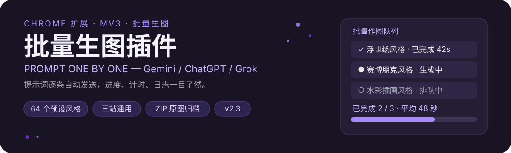

<p align="right"><a href="README.md">中文</a></p>

<p align="center">
  
</p>

<p align="center">
  <a href="https://xiaosang.cc/prompt-one-by-one/">▶ Project Page</a>
  ·
  <a href="https://github.com/holynova/prompt_one_by_one/releases/latest">⬇ Latest Release</a>
  ·
  <a href="https://github.com/holynova/prompt_one_by_one">GitHub Repository</a>
</p>

Prompt One by One is a Chrome extension (Manifest V3) that injects a 340px sidebar into Gemini, ChatGPT, and Grok pages: paste one prompt per line and it sends them one by one, waits for each image, and logs the time each one took. It ships 64 built-in style prompts, and finished images can be packed into a ZIP with one click.

> No screenshots yet: the sidebar only renders inside the live Gemini / ChatGPT / Grok pages, so it can't be captured offline; the repo has no UI screenshots either. The queue card on the right of the hero is a mockup of the interface.

## Features

- **Batch queue**: one prompt per line, sent automatically one by one; supports prefix / suffix (auto-appended to every prompt) and shuffle.
- **Pause / resume / stop**: pause or stop anytime while running; a paused queue resumes from where it left off.
- **Send intervals**: configurable fixed interval with random jitter (minute-level), plus auto new-chat every N prompts.
- **Live timing & dashboard**: per-prompt time from send to image, with current / total / average times and a progress bar at a glance.
- **Scrolling log**: key events — queue start, each send, each image, pause, completion — all timestamped.
- **64 built-in styles**: 15 groups (animation & illustration, sci-fi & fantasy, traditional & cultural, historical & art movements, and more); filter by multi-select dropdown, load all, or pick 5 at random.
- **Reference image upload**: upload an image as a reference for image-to-image prompts.
- **Original-image archive**: one click extracts every full-resolution image on the page (deduplicated, highest resolution), packed into a ZIP locally, up to 5 concurrent downloads.
- **Wake lock**: holds a wake lock while running so the computer doesn't sleep mid-queue.
- **Three sites, one extension**: Gemini, ChatGPT (including the legacy domain), and Grok each have their own page adapter (input box, send button, image detection).

## Install

The extension is not on the Chrome Web Store; load it manually:

1. Download the zip from the [latest Release](https://github.com/holynova/prompt_one_by_one/releases/latest) and unzip it
2. Open `chrome://extensions/` and turn on 「开发者模式」 ("Developer mode") at the top right
3. Click 「加载已解压的扩展程序」 ("Load unpacked") and select the unzipped folder
4. Open [gemini.google.com](https://gemini.google.com) (or ChatGPT / Grok) — the sidebar appears on the right
5. Click the extension icon in the toolbar to show / hide the sidebar; clicking it on other pages opens a new Gemini page

Cutting a release: pushing a `v*` tag makes GitHub Actions build the zip and create the Release automatically (see `.github/workflows/release.yml`).

## Privacy

- No personal data or prompts are collected or uploaded: prompts go straight from the browser to the third-party site you're logged into (Gemini / ChatGPT / Grok), never through a developer server.
- Settings and prompts stay in local browser storage; no accounts, no analytics / ad SDKs, no telemetry.
- Permissions: `downloads` (saving the ZIP) and host permissions for `*.google.com` / `*.googleusercontent.com` (reading Gemini image resources); content scripts only inject on gemini.google.com, chatgpt.com, chat.openai.com, and grok.com.
- Full details in `PRIVACY.md`.

## Tech

- Manifest V3: Service Worker (`background.js`) + content scripts (`jszip.min.js`, `prompts.js`, `automation.js`, `sidebar.js` + `sidebar.css`).
- `sidebar.js` injects the sidebar 3 seconds after page load (340px wide, collapsible, drag-to-resize); `automation.js` simulates input, watches for new images, and runs the queue per site config (`SITE_CONFIGS`); `background.js` handles ZIP packing/downloads and image base64 fetching.
- Zero build, zero dependencies (except the single-file JSZip used for packing).

```
manifest.json           MV3 manifest: permissions, host permissions, four-site content script matches
background.js           Service Worker: icon clicks, ZIP packing/downloads, image fetching
sidebar.js              Sidebar UI: queue, dashboard, log, style picker, upload, download
sidebar.css             Sidebar styles (340px)
automation.js           Queue execution: simulated input, image watching, intervals, new chats, wake lock
prompts.js              64 built-in style prompts (15 groups)
jszip.min.js            ZIP packing (single-file include)
icon128.png             Extension icon
PRIVACY.md              Privacy policy
.github/workflows/      Tag-triggered automatic releases
```
